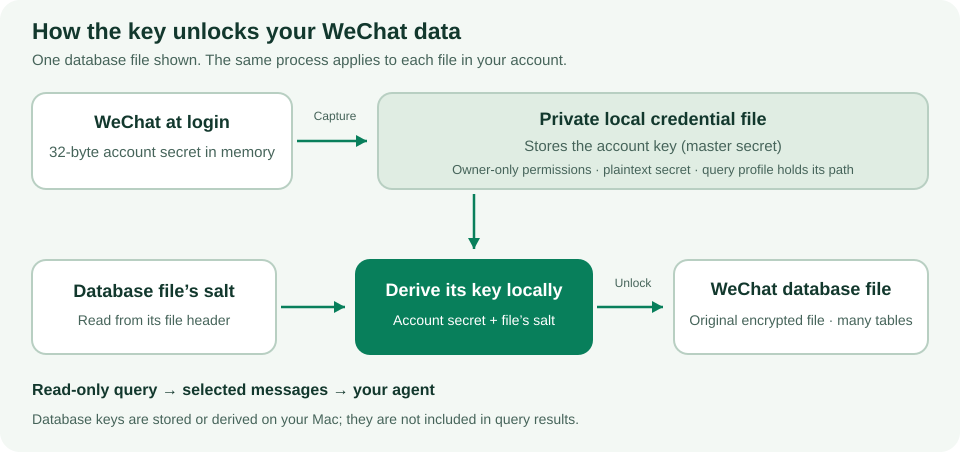

# Getting your database key

WeChat encrypts the chat databases it keeps on your Mac. To read them,
GreenBubbles needs your account's key. This page shows how to copy that key
out of your own running WeChat app. You only do this once.

The [README](../README.md#getting-your-database-key) has the short version.



## Before you start

- **You need administrator access.** The capture step runs with `sudo`.
- **You will re-sign your copy of WeChat.** This replaces Apple's security
  signature on WeChat with a local one, so the capture tool is allowed to
  attach to it. WeChat keeps working normally. When WeChat updates, it gets its
  original signature back, and you re-sign it again only if you need to capture
  the key again.
- **You will log out of WeChat and log back in** during the capture.
- **The key cannot be changed.** It opens every copy of your WeChat data,
  including old backups. The tool saves it in a file only your account can
  read. Keep it that way, and never paste it into an AI prompt, an issue, or a
  chat.

## Steps

1. **Start WeChat and log in.**

2. **Check that everything is ready:**

   ```sh
   greenbubbles-acquire preflight
   ```

   It prints a checklist and says `Ready to capture.` when nothing is missing.
   If something is wrong, it prints how to fix it. Common fixes:

   - `lldb is not available`: install Apple's developer tools with
     `xcode-select --install`.
   - `Hardened Runtime is still active`: re-sign WeChat (next step).
   - `not running as root`: expected for this check. The capture itself runs
     with `sudo`.

3. **Re-sign WeChat, then quit and restart it.** Run this yourself;
   GreenBubbles never runs it for you:

   ```sh
   sudo codesign --force --deep --sign - /Applications/WeChat.app
   ```

4. **Start the capture:**

   ```sh
   sudo greenbubbles-acquire capture
   ```

5. **In WeChat, log out of your account (don't just quit the app), then log
   back in.** You have 5 minutes by default.

When the login finishes, the tool checks the key against your databases and
saves it to `~/.greenbubbles-acquire/passphrase.txt`. Now you can run ordinary
commands with no extra setup:

```sh
greenbubbles chats --limit 20
```

## Command options

```sh
greenbubbles-acquire preflight [--json] [--profile <name>] [--db-root <path>] \
  [--pid <n>]
greenbubbles-acquire capture [--profile <name>] [--output <path>] \
  [--timeout-seconds 300] [--db-root <path>] [--pid <n>] [--overwrite]
greenbubbles-acquire verify --passphrase-stdin [--profile <name>] [--db-root <path>]
```

- **`preflight`** checks that WeChat is installed and running, whether it has
  been re-signed, whether `lldb` is available, whether you are root, and how
  many databases it found. It exits with an error if anything blocks the
  capture. `--json` prints the report as JSON.
- **`capture`** runs the same checks, then waits for you to log out and back
  in. `--timeout-seconds` changes the 300-second wait. `--output` saves the key
  somewhere other than `~/.greenbubbles-acquire/passphrase.txt`. It never
  replaces an existing key file unless you add `--overwrite`.
- **`verify`** checks a saved key against your databases without touching
  WeChat. Pipe the key file into it. Use it after WeChat creates new database
  files; the same key opens them, so you don't need to capture again.
- **`--profile`** uses a live [query profile](QUERY_PROFILES.md): its
  `sourceRoot` is the data folder and its `credentialFile` is where `capture`
  writes the key. Without `--profile`, the tool picks the same source as an
  ordinary `greenbubbles` query:
  1. When `~/.greenbubbles/query-profiles.json` exists, its `defaultProfile`.
     A file with no `defaultProfile` is an error; pass `--profile`. A file
     whose only profile still has the `/ABSOLUTE/...` template path counts as
     no file.
  2. Otherwise `~/.greenbubbles/config.toml`: `profile.default`, or
     `source.root` and `source.passphrase_file`. The tool reads only plain
     `[table]` headers and `key = "string"` lines there.
  3. Otherwise the discovered data folder and
     `~/.greenbubbles-acquire/passphrase.txt`.

  The profile must use `liveWeChatKeyFile` access; a snapshot or decrypted
  profile is an error unless you give both `--db-root` and `--output`.
  `--output` overrides the key file. `--db-root` overrides the data folder;
  when a profile or `config.toml` sets the data folder, `capture` refuses a
  different `--db-root` unless you also pass `--output`, so one account's key
  never replaces the key file another account's queries read (including the
  default file when `config.toml` sets only `source.root`). When `config.toml`
  sets only `source.passphrase_file`, any `--db-root` needs `--output` too.
  Roots are compared after resolving symbolic links, and a data folder path
  (`--db-root`, `sourceRoot`, `source.root`) may not contain `..`.
  `preflight` applies the same checks, so it reports ready only for a
  target `capture` would accept, and its suggested command keeps
  `--profile`, `--db-root`, `--output`, `--pid`, and any `--preserve-env` you need. Both files are read with the same rules as the
  `greenbubbles` CLI (owner-only file in an owner-only folder, no symbolic
  links, at most 64 KiB, `formatVersion` 1, no unknown fields).
  `GREENBUBBLES_QUERY_PROFILES_FILE` and `GREENBUBBLES_CONFIG_FILE` must be
  absolute paths (the second is checked only when `config.toml` is used). `sudo` removes them from the environment by default; keep
  them with `sudo --preserve-env=GREENBUBBLES_QUERY_PROFILES_FILE,GREENBUBBLES_CONFIG_FILE`
  or the tool reads the files in your home folder.
- **`--db-root`** points at a specific WeChat data folder. The tool selects a root
  automatically only when discovery finds exactly one. With several accounts,
  choose the intended directory explicitly.
- **Which WeChat process is used:** the tool attaches to your own WeChat
  process whose app owns the data folder. A folder inside
  `~/Library/Containers/<bundle id>/` belongs to the app with that bundle ID,
  so with two copies of WeChat running (for example a duplicate made to run a
  second account), the copy that owns the selected account is chosen whatever
  its process ID. Preflight shows the chosen process ID and bundle ID. If that
  copy isn't running, or several of its processes are, preflight stops instead
  of guessing. WeChat processes of other macOS users are never considered.
- **`--pid`** chooses the WeChat process yourself. It must be your own
  process, running a WeChat app's main executable, and when the data folder is
  in an app container that app must own it. You need it when the data folder
  is in a group container or anywhere else outside an app container, because
  then the owning app can't be told from the path. It also picks one of two
  instances of the same app; the capture then keeps that process and, if it
  restarts at logout, follows only a new process, never the other instance.
  The suggested capture command after a successful preflight repeats it. To
  list the running copies and their apps: `pgrep -lf /Contents/MacOS/WeChat`.

The WeChat version is shown for information only. The tool does not refuse a
version it hasn't seen. Confirmed captures are listed under
[What has been tested](#what-has-been-tested).

## If something goes wrong

A successful preflight checks prerequisites only. If database verification
fails, the command exits with an error before creating or replacing the output
file, even when `--overwrite` was requested. Any file already at the output
path belongs to an earlier run.

- **"Hardened Runtime is still active":** you haven't re-signed WeChat, or you
  didn't restart it after re-signing. macOS blocks the attach. Preflight checks
  the selected process and reads the version and signature from that process's
  own app, so for a duplicated copy it prints the re-sign command for that
  copy. Add `--include-paths` to show that copy's path in the command.
- **"The WeChat app that owns the database root … is not running":** another
  WeChat copy is running, but the selected account belongs to a different
  copy. Start that copy and log in, or pick another account with `--db-root`.
- **"… WeChat processes belong to …" or "Multiple WeChat processes":** more
  than one process could be the target. Quit the extras, or choose one with
  `--pid`.
- **"The database root is not inside a WeChat app container":** the data
  folder is in a group container or another location. Choose the process with
  `--pid`.
- **"Process … runs …, but the database root belongs to …":** the `--pid`
  process is a different copy of WeChat from the one that owns the data.
- **Timed out:** you didn't log out and back in within the time limit. Run
  `capture` again. An idle, logged-in WeChat never reveals the key.
- **Verification failed:** no database salt group matched any captured
  candidate, so nothing was saved. The tool keeps waiting past a candidate that
  doesn't match until the time limit. The diagnostic reports the counts of
  groups and files examined. These counts do not identify the cause or
  establish compatibility with the installed build. Check that you logged back
  into the same account.
- **WeChat updated:** re-sign it and restart it before capturing again. A key
  you already saved keeps working as long as `verify` succeeds.

## Where the key is saved

If you use [query profiles](QUERY_PROFILES.md), the key goes to the profile's
`credentialFile` instead (see `--profile` above).

Although `capture` runs with `sudo`, it reads the profile files, finds and
reads the databases, and writes the key with the rights of the account that
ran `sudo` (checked against `SUDO_UID`); only the debugger attach uses root.
The key file and any folders it creates therefore
belong to you, and the tool cannot create or replace a file anywhere you could
not write yourself. It refuses an existing file that belongs to someone else, a
key path containing `.` or `..`, and an output folder that is a symbolic link
(use `/private/tmp`, not `/tmp`). `greenbubbles` reads a key only from a folder
you own with mode `700`; `capture` prints a note when the folder is wider.

The data folder must be a real folder you own, not a symbolic link, as the
`greenbubbles` CLI requires. To check this behaviour on your Mac with
synthetic data only, run `scripts/sudo-smoke-test-acquire.sh` from a checkout
(as yourself; it calls `sudo` for the privileged steps).

The key is saved as 64 hexadecimal characters in
`~/.greenbubbles-acquire/passphrase.txt`. The output file has mode `0600`.
New output directories use mode `0700`. When you choose an existing directory,
its original permissions are preserved. File permissions protect the unencrypted
output. The key never appears on the command line, in
a report, or in a log.

To use a key saved somewhere else, or to read a second account or a backup,
create a [query profile](QUERY_PROFILES.md). You can also pipe a key directly
into a command:

```sh
cat <passphrase-file> | greenbubbles conversations list \
  <db_storage-directory> --passphrase-stdin --limit 20
```

If you think the key has leaked, see
[OPERATIONAL_RESPONSE_PLAN.md](OPERATIONAL_RESPONSE_PLAN.md). Because the key
can't be changed, the response is about finding and removing copies.

## How it works

You don't need this section to use GreenBubbles.

WeChat uses SQLCipher to encrypt each database file. Your account has one
32-byte key. For each file, WeChat combines that key with a random value stored
at the start of the file (the salt) to make the file's own encryption key. So
there is one account key, not one key per file or table. See the
[SQLCipher design](https://www.zetetic.net/sqlcipher/design/).

WeChat makes those per-file keys only while it opens its databases, which
happens when you log in. It does this by calling a macOS system function,
`CCKeyDerivationPBKDF`. That is the one moment the account key can be seen, and
it is why you have to log out and back in.

`greenbubbles-acquire capture` does this:

1. Attaches Apple's `lldb` debugger to WeChat and pauses on
   `CCKeyDerivationPBKDF` only for the SQLCipher account-key derivation:
   PBKDF2, a 32-byte password, a 16-byte salt, HMAC-SHA512, and 256,000
   rounds. Other calls, including other 32-byte passwords, are ignored.
2. When you log back in, it reads those 32 bytes (from register `x1` on
   Apple silicon, `rsi` on Intel). It reads nothing else and changes nothing
   in WeChat. If those bytes do not open your databases, it keeps waiting for
   another matching call until the time limit. It detaches after a candidate
   checks out, or when the time limit expires. Because it pauses on a macOS
   function rather than on WeChat's own code, it does not depend on a
   particular WeChat version, as long as that version derives the account key
   with these parameters.
3. On WeChat 4.1.13, logging out ends the WeChat process and logging in starts
   a new one. The tool notices and follows the new process of the same app
   copy (same app path and bundle ID), never another copy that is running.
   It only accepts a process that started after it saw the old one exit, so
   another instance that was already running is never taken for the new one.
   If none qualifies, it keeps waiting until the time limit.
4. For each database file, it computes the file's key on your Mac
   (PBKDF2-HMAC-SHA512, 256,000 rounds, with that file's 16-byte salt).
5. It proves each computed key is correct by checking SQLCipher 4's
   authentication code on the file's first page. A candidate that fails this
   check is discarded and capture continues. A key is written only after at
   least one database accepts it.

Only the account key is saved. The per-file keys exist in memory only during
the check and are then erased.

GreenBubbles features that don't read live WeChat data, such as opening an
existing backup, never use this capture.

## What has been tested

- **2026-08-27, WeChat 4.1.12:** a test with made-up data reproduced the read
  and key computation exactly. Then a real capture on the author's own Mac and
  account verified all 25 databases. A database WeChat created later was
  verified with `verify` using the same key, without a second capture.
- **2026-08-28, WeChat 4.1.13:** after WeChat auto-updated and was re-signed, a
  capture verified all 26 databases in 45 seconds. Logging out ended the WeChat
  process and logging in started a new one; the capture followed it.
- **2026-10-31, WeChat 4.2.0 (build 270345), macOS 27.0.1, Apple silicon:**
  GreenBubbles v0.10.0 stopped on an unrelated 32-byte `CCKeyDerivationPBKDF`
  call. Verification failed and nothing was written. A capture that instead
  required PBKDF2, a 32-byte password, a 16-byte salt, HMAC-SHA512, and
  256,000 rounds verified all 26 databases (26 distinct salts). Live reads
  then succeeded. On WeChat 4.1.15 (build 270100), macOS 26.6.2, Apple
  silicon, the same parameter filter plus verification before giving up was
  reported to succeed against 22 databases.

These are specific Macs, WeChat versions, and accounts. They are not a promise
that it will work on your Mac, your WeChat version, or your account.

## Credits

The capture method is ported from the MIT-licensed
[`TANGandXUE/wcdb-key-tool`](https://github.com/TANGandXUE/wcdb-key-tool),
which credits kkocdko, wxchat-export, and ylytdeng/wechat-decrypt. See
[NOTICE.md](../NOTICE.md). GreenBubbles does not download or run that tool; it
reimplements the method.

How other projects get the same key, and why this method was chosen, is in
[`archive/ACQUISITION_FEASIBILITY.md`](archive/ACQUISITION_FEASIBILITY.md).
